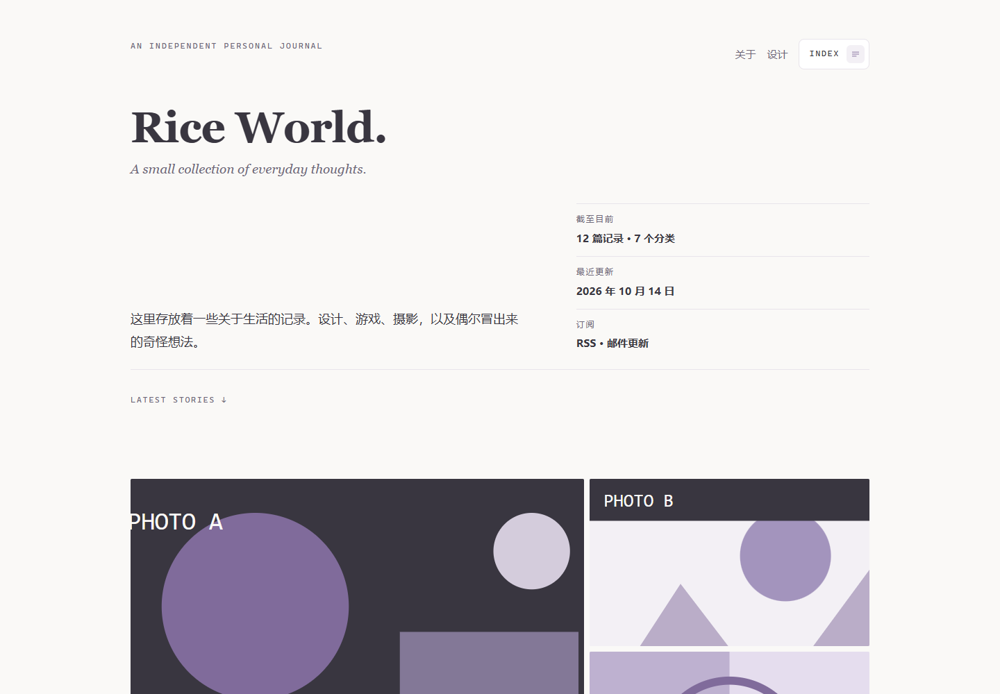

# Rice World

**RiceNote 的编辑式个人刊物主题** —— 首页把「一篇文章」当作一个版面单元来排，文章页则是一份安静的阅读版面。

零构建：Nunjucks 模板 + 一份 CSS + 一份原生 JS，改完文件即生效，没有打包步骤。



- **首页七种拼版** —— 按文章自带的图片数量（0–4 张）自动排成纯文字、单图、通栏大图、背景封面、双图、三图主次、四图拼版；
- **沉浸阅读** —— 紧凑顶栏（文章标题单行渐隐、下滑收起、上滑回来）、目录抽屉、阅读进度线、字号与深浅主题切换、图片懒加载与占位图、图片查看器；
- **页面过渡** —— Swup 接管跳转，页头与主内容整段替换，不整页白闪；
- **深浅双主题** —— 各自一套语义 token（不是简单反转），可跟随系统，也可在「阅读设置」里手动切换；
- **全站零依赖** —— 不引入任何前端框架与字体文件，Swup 已随主题内置。

| | |
|---|---|
| 主题 ID | `rice.world` |
| 当前版本 | 1.5.1 |
| 模板引擎 | Nunjucks（`engine: nunjucks`，API `^1.0.0`） |
| 必需插件 | `content.posts@1`（内容主体） |
| 可选插件 | 搜索、评论、友情链接、订阅源（未启用时对应入口自动隐藏） |
| 许可 | MIT |

---

## 目录

- [安装](#安装)
- [内置页面](#内置页面)
- [页面版式](#页面版式)
- [文章级字段与七种首页拼版](#文章级字段与七种首页拼版)
- [主题设置](#主题设置)
- [短代码](#短代码)
- [插件插槽](#插件插槽)
- [目录结构](#目录结构)
- [二次开发须知](#二次开发须知)

---

## 安装

### 方式一：后台上传 ZIP

「外观 → 主题 → 上传主题」选择主题 ZIP，安装后在主题列表里启用。
主题 ZIP 内的结构是 `rice.world/theme.json`（平台兼容「包内多套一层目录」）。

> 打包时注意平台的扩展名白名单：只允许 `.json` `.njk` `.html` `.css` `.js` `.png` `.jpg` `.svg` `.txt` `.md` 等静态资源类型。
> `.gitignore` 这类**没有扩展名的点文件不在白名单内**，打进去会让整个包被拒（判定为「不允许的文件类型」）；
> 条目名也必须用 `/` 分隔，用 `\` 会被判定为绕过尝试。

### 方式二：覆盖主题目录

把主题目录整体覆盖到站点的 `themes/rice.world/`，然后**重启进程**。

两种方式覆盖后都建议硬刷新页面一次。

> **为什么要重启**：渲染器在内存里缓存已编译的模板与整页 HTML。同 id 主题的文件被替换时这两层缓存不会自动失效，
> 重启进程最省事；调 CSS/JS 时另需提版本号（见 [二次开发须知](#二次开发须知)）。

---

## 内置页面

主题清单 `templates` 声明了七类页面的模板，另有一个约定文件名 `fallback.njk` 兜底：

| 页面类型（kind） | 模板文件 | 路径 | 说明 |
|---|---|---|---|
| `home` | `index.njk` | `/` | 刊头 + 简介 + 信息流（每篇按 `homeLayout` 拼版）+ 分页 |
| `post` | `post.njk` | `/post/:slug` | 紧凑顶栏、文章主图、正文、标签、评论；目录与阅读设置抽屉按设置出现 |
| `page` | `page.njk` | `/page/:slug` | 独立页面，默认版式（页面版式可选，见下节） |
| `archive` | `archive.njk` | `/category/:slug`、`/tag/:slug` | 分类页与标签页共用，按年份分块列出条目 |
| `search` | `search.njk` | `/search` | 站内搜索（需启用搜索插件） |
| `links` | `links.njk` | `/links` | 友情链接页（需启用友情链接插件） |
| `404` | `404.njk` | 未匹配路径 | 未找到页面，含回首页与搜索入口 |
| — | `fallback.njk` | — | 以上都匹配不到时使用的通用版式（第三级回退） |

**模板解析顺序**（平台按此选择要渲染的文件）：

1. 内容上指定的模板（文章 / 页面在后台选的版式）；
2. 内容上指定的是一个存在的 `.njk` 文件名时直接使用；
3. 清单 `templates[kind]` 声明的模板；
4. 主题根目录下的 `fallback.njk`；
5. 平台内置的兜底模板（主题未提供 `fallback.njk` 时）。

---

## 页面版式

页面版式（`pageTemplates`）决定**独立页面**的排版，在后台「页面」编辑界面的「模板」下拉里选择 ——
同一份清单也会出现在**文章**编辑界面里，所以文章也能用这三种版式。

| 版式键 | 模板文件 | 说明 |
|---|---|---|
| `default` | `page.njk` | 标准页面：标题 + 正文 + 最后更新时间 |
| `plain` | `page-plain.njk` | 落地页（无标题）：不输出标题区，适合标题已写在正文里的页面 |
| `narrow` | `page-narrow.njk` | 阅读版式（窄栏）：正文收窄居中，适合关于页、条款与长文 |

三种版式都带页头与页脚，正文容器均为 `.prose`，因此**短代码在三种版式里都可用**。

---

## 文章级字段与七种首页拼版

主题往后台的文章编辑页增加了以下字段（清单里的 `contentFields`）。它们只影响**这篇文章在首页的呈现**：

| 字段 | 类型 | 默认 | 说明 |
|---|---|---|---|
| `homeLayout` | select | `text` | 首页展示这篇文章时使用的拼版 |
| `homeImage1` – `homeImage4` | image | 空 | 首页展示图 1–4，填媒体库地址（如 `/media/12`）或完整 URL |
| `homeFocus1` – `homeFocus4` | select | `center` | 展示图 1–4 的焦点位置（居中 / 偏上 25% / 偏上 35% / 偏下 65% / 偏下 75% / 顶部 / 底部 / 左侧 / 右侧） |

### 七种拼版

| `homeLayout` | 图片数 | 版式 |
|---|---|---|
| `text` | 0 | 纯文字，不显示图片 |
| `single` | 1 | 单图 |
| `hero` | 1 | 通栏大图 |
| `background` | 1 | 背景封面，标题叠在图片上（窄屏自动缩小封面并隐去摘要） |
| `double` | 2 | 双图并置（4:5 两列） |
| `triple` | 3 | 三图主次：主图 4:3 + 右侧两副图等高堆叠（≤920px 改为上下排列） |
| `quad` | 4 | 四图 2×2（桌面 4:3，≤1199px 3:2，≤600px 1:1） |

- 「只有一张图」的三种版式里，`single` 与 `hero` **共用同一个高度**（见设置「单图版式高度」），
  让首页的单元高度保持一致；`background` 因为要承载叠字，单独用「背景封面高度」。
- 图片不足时自动降级为相称的版式（例如选了四图但只填了两张）。
- 焦点位置用来决定图片裁切时保留哪一部分（对象定位），适合人物照、竖图。

---

## 主题设置

「外观中心 → 主题设置」共 **8 组**。以下默认值即首次启用时的取值。

### 外观

| 字段 | 类型 | 默认 | 说明 |
|---|---|---|---|
| 强调色 | color | `#806B9B` | 用于链接、目录当前项、阅读进度与焦点环 |
| 柔和强调色 | color | `#A394BD` | 用于非关键装饰，如序号与细线 |
| 首页内容宽度 | number | `1160`（960–1440） | 单位 px |
| 正文与刊头字体 | select | 系统无衬线 | 另可选「无衬线正文 + 衬线刊头」 |
| 默认阅读主题 | select | 跟随系统 | 跟随系统 / 浅色 / 深色 |
| 启用动效 | boolean | 开 | 关闭后等同系统的「减少动态效果」，仅保留必要反馈 |

### 图片加载

| 字段 | 类型 | 默认 | 说明 |
|---|---|---|---|
| 启用图片懒加载 | boolean | 开 | 关闭后所有图片立即加载 |
| 加载中占位图 | image | 空 | 留空只用占位底色；可填媒体库地址 |
| 占位底色 | color | `#F3F0F5` | |
| 占位图填充方式 | select | 裁切填满 | 裁切填满 / 完整显示 |
| 加载完成后淡入 | boolean | 开 | |
| 首屏立即加载图片数 | number | `2`（1–4） | 只作用于每页第一个图片区块 |

### 首页

| 字段 | 类型 | 默认 | 说明 |
|---|---|---|---|
| 刊头英文副标签 | text | `An independent personal journal` | |
| 刊头副标题 | text | `A small collection of everyday thoughts.` | |
| 简介文字 | textarea | 一段中文说明 | |
| 简介事实条目 | stringList | 空 | 每行一条，形如 `截至今天\|12 篇记录`，最多 6 条 |
| 显示简介区 | boolean | 开 | |
| 单图版式高度 | select | `16 / 9` | 同时作用于「单图」与「通栏大图」；另可选 3:2、4:3、2:1 |
| 背景封面高度 | select | `20 / 9` | 「背景封面」单独使用；可选 16:9（与单图一致）、2:1 |

### 评论

| 字段 | 类型 | 默认 | 说明 |
|---|---|---|---|
| 显示评论头像 | boolean | 开 | |
| 邮箱头像服务地址 | url | `https://weavatar.com/avatar/` | Gravatar 协议；留空则只用「无邮箱时头像」 |
| 无邮箱时头像 | select | 昵称首字 | 另可选「评论者站点图标」（会向对方站点取一次 favicon） |
| 评论顺序 | select | 最新在前 | 插件固定返回「最早在前」，由主题在渲染后重排，每层回复同样生效 |

### 目录与导航

| 字段 | 类型 | 默认 | 说明 |
|---|---|---|---|
| 「关于」页面缩略名 | text | `about` | 留空则不显示「关于」入口 |
| 显示搜索入口 | boolean | 开 | 搜索插件未启用时自动隐藏 |
| 显示友情链接入口 | boolean | 开 | 友链插件未启用时自动隐藏 |
| 目录面板页脚文字 | text | 一句话 | 显示在 INDEX 抽屉底部 |
| 悬浮 INDEX 位置 | select | 页头位置 | 另可选「右下角」；首页与文章页共用同一个悬浮入口 |

### 阅读

| 字段 | 类型 | 默认 | 说明 |
|---|---|---|---|
| 显示阅读进度线 | boolean | 开 | 文章页顶栏下沿的进度线，只统计正文区域 |
| 显示文章目录 | boolean | 开 | 文章页的目录与抽屉入口 |
| 显示阅读设置 | boolean | 开 | 字号 / 阅读主题 / 复制链接 |
| 默认正文字号 | select | 标准 | 小 / 标准 / 大（读者可在「阅读设置」里临时改，偏好存本地） |

### 友情链接

| 字段 | 类型 | 默认 | 说明 |
|---|---|---|---|
| 友链页说明 | textarea | `一些长期阅读的站点。` | |
| 友链页页脚文字 | text | `想交换链接可以通过关于页联系我。` | |
| 显示头像 | boolean | 开 | |
| 显示简介 | boolean | 开 | |
| 桌面列数 | number | `3`（1–4） | |
| 在新窗口打开 | boolean | 开 | |

### 页脚

| 字段 | 类型 | 默认 | 说明 |
|---|---|---|---|
| 页脚文字 | text | `Rice World · 一本持续更新的小刊物` | |
| 备案链接 | url | 空 | 可留空；填写后页脚显示「备案信息」链接 |
| 显示订阅入口 | boolean | 开 | 需要启用「订阅源」插件 |
| 订阅源地址 | text | `/feed.xml` | 订阅源插件默认输出 `/feed.xml` |
| 社交链接 | stringList | 空 | 每行一条，形如 `名称\|https://…`，最多 10 条 |

---

## 短代码

短代码由内核提供引擎与注册 API、语义由主题定义。主题在 `assets/js/shortcodes.js` 里注册了四个标记，
**文章正文与三种页面版式**都可用（正文容器带 `data-rn-shortcodes` 才会被扫描）。

| 标记 | 作用 |
|---|---|
| `[note]` | 左侧细线的提示块 |
| `[figure]` | 带图注的图片 |
| `[gallery]` | 多图并置 |
| `[photos]` | 瀑布流相册 |

```
[note title="说明"]这里是提示内容，内部支持行内标记与换行。[/note]
[note title="注意" tone="alert"]tone="alert" 会用文字色强调。[/note]

[figure src="/media/12" alt="海边" wide]图片下方这行是图注（也可以改用 caption="…"）[/figure]

[gallery]
  
  
[/gallery]

[photos]海边的黄昏, /media/21 ### 拍糊了, /media/22 ### /media/23[/photos]
```

使用要点：

- `[photos]` 用 `###` 分隔每张照片，每张里**逗号前是描述、逗号后是地址**（描述可省略、只写地址也行）；
  描述自身带逗号时，第一个「像地址的片段」会被识别为地址，所以两种写法都能用。
- 地址只接受 `http(s)://`、`/media`、`/uploads`、`/assets`、`/theme-assets` 与 `./` 开头的相对路径（阻断伪协议）。
- 一个地址都认不出来时，标记会**原样保留**在页面上（不会静默输出空相册），便于发现写法写错。
- 引擎**不支持嵌套**，这些标记内部不要再放其它短代码；代码块、行内代码、`<script>`、`<style>` 与 HTML 注释里的内容不会被解析。
- 摘录、搜索、SEO 与 RSS 等纯文字场合，服务端会剥离短代码标记，不会把 `[note]` 之类漏给读者。
- `[figure]` / `[gallery]` / `[photos]` 产出的图片与正文图片同一套契约，可点击放大（灯箱）。

---

## 插件插槽

主题留出了平台约定的全部 **9 个插槽**，且都做了空插槽判断（插件未启用时不留空壳）：

| 插槽 | 主题里的位置 |
|---|---|
| `head.end` | `</head>` 之前 |
| `body.start` | `<body>` 开头（跳转链接之后） |
| `body.end` | `</body>` 之前 |
| `header.navigation` | INDEX 抽屉内的导航区；为空时抽屉退化为一个「回首页」入口 |
| `sidebar.widgets` | 单列版面没有侧栏，改落在页脚上方 |
| `post.beforeContent` | 文章正文之前（主图之后） |
| `post.afterContent` | 文章正文之后、标签之前 |
| `post.comments` | 文章页评论区 |
| `footer.widgets` | 页脚底部 |

> 注：`post.afterContent` 里插件注入的块会全部显示。主题自身已在更下方渲染标签行，
> 若某个插件注入的内容与主题重复，可在 CSS 里按类隐藏（主题已按此处理过 `rice.posts` 的「相关 / 最后更新于」两块）。

---

## 目录结构

```
rice.world/
├─ theme.json                  主题清单（id / 版本 / 模板映射 / 页面版式 / 设置 / 内容字段）
├─ screenshot.png              后台主题列表的预览图
├─ README.md
├─ templates/                  固定目录名，平台在此查找模板
│  ├─ layout.njk               全局壳：head、Swup 替换区、抽屉与灯箱、脚本引入
│  ├─ index.njk                首页
│  ├─ post.njk                 文章页
│  ├─ page.njk                 独立页面（标准版式）
│  ├─ page-plain.njk           独立页面（落地页，无标题）
│  ├─ page-narrow.njk          独立页面（窄栏阅读版式）
│  ├─ archive.njk              分类页 / 标签页
│  ├─ search.njk               搜索页
│  ├─ links.njk                友情链接页
│  ├─ 404.njk                  未找到
│  ├─ fallback.njk             通用回退版式
│  └─ partials/                可任意组织的局部模板（15 个）
│     ├─ header-home.njk / header-compact.njk        两种页头
│     ├─ index-drawer.njk / index-fab.njk            目录抽屉与悬浮入口
│     ├─ toc-panel.njk / reading-tools.njk           文章目录、阅读设置
│     ├─ editorial-entry.njk / entry-parts.njk / list-rows.njk   三类列表单元
│     ├─ friend-link-card.njk / pagination.njk       友链卡片、分页
│     ├─ image.njk / image-lightbox.njk              图片宏、查看器
│     ├─ date-macros.njk / site-footer.njk           日期宏、页脚
└─ assets/
   ├─ css/rice-world.css       全部样式（含 8 个分组小节的注释）
   ├─ js/rice-world.js         全部交互：过渡、抽屉、目录、进度、懒加载、灯箱、评论排序…
   ├─ js/shortcodes.js         短代码定义
   └─ vendor/swup/             Swup 与其 Head 插件（含 LICENSE）
```

---

## 二次开发须知

### 改完要提版本号

`theme.json` 的 `version` 在平台上不只用于显示，还被当作**缓存键**：

- 静态资源 URL 形如 `/theme-assets/rice.world/css/rice-world.css?v=1.5.1` —— 指纹取自主题版本。
  **改了 CSS/JS 却不提版本，访客浏览器会继续用旧缓存**；
- Nunjucks 环境缓存键是 `<主题 id>@<主题版本>` —— 改了模板却不提版本，已编译的模板不会被重新编译；
- 整页 HTML 缓存的键**不含主题版本**（用的是设置发布 revision、站点信息 revision、启用插件集合与路径），
  所以替换同 id 主题的文件后**需要重启进程**才会清空。

实践上：改模板或资源 → 提一个补丁位（`1.5.1` → `1.5.2`）→ 覆盖文件 → 重启 → 硬刷新。

### 清单字段（`theme.json`）

必填 `schemaVersion` `id` `name` `version` `apiVersion` `engine` `templates`；可选
`description` `author` `license` `screenshot`（须以 `./` 开头的相对路径）`pageTemplates` `requires` `settings` `contentFields`。
**未列出的字段一律非法**（清单 schema 是 `additionalProperties: false`）。

设置字段支持的类型：`text` `textarea` `color` `boolean` `number` `select` `image` `url` `stringList`；
每项可用 `label` `description` `default` `min` `max` `maxLength` `maxItems` `placeholder` `options`；
`select` 必须提供 `options`（数组，元素为 `{ label, value }`）。文案字段都接受多语言对象，如 `{ "zh-CN": "…", "en": "…" }`。

### 模板里可用的东西

- **变量**：`site`（站点信息）、`theme`（含扁平化的 `theme.settings.*`）、`page`（`kind` / `title` / `canonicalUrl`）、
  `post`（`title` `html` `excerpt` `coverUrl` `authorName` `publishedAt` `updatedAt` `terms[]` `fields`）、
  `posts`（列表分页数据）、`content`（独立页面的正文）、`pagination`、`seoDescription`；
- **函数**：`url(名字, 参数)`（命名路由，未注册时返回 `#` 而不会报错）、`has_feature('插件名')`（判断插件是否在运行）、
  `theme_asset('路径')`（带版本指纹的资源 URL）、`site_url(路径)`、`slot(名字, 数据)`、`shortcode_runtime()`；
- **过滤器**：`css_color`（颜色白名单，非法值回退）、`date`（`YYYY` `MM` `DD` `HH` `mm` `ss`）、`excerpt` `number` `json`。

注意：`slot()` 与 nunjucks 宏的返回值都是 **SafeString（恒为真值）**，判断插槽是否为空要用 `.length`。

### 插件依赖

`templates` 之外的页面类型由插件注册，主题端用 `has_feature()` 判断后再渲染入口：

| 能力 | 提供方 | 主题里的用法 |
|---|---|---|
| `posts`（必需） | `content.posts` | 首页信息流、文章页、分类 / 标签页 |
| `search` | 搜索插件 | 搜索页、页脚与 404 页的搜索入口 |
| `comments` | 评论插件 | 文章页评论区 |
| 友链 | 友情链接插件 | `/links` 页面（`links.njk`） |
| 订阅源 | 订阅源插件 | 页脚订阅入口，默认 `/feed.xml` |

### 打包成 ZIP 时

只打包白名单内的扩展名、条目名用 `/` 分隔，否则后台会拒绝安装（详见 [安装](#安装)）。

---

## 许可

MIT。Swup 及其 Head 插件按各自许可（见 `assets/vendor/swup/` 内的 LICENSE 文件）。
